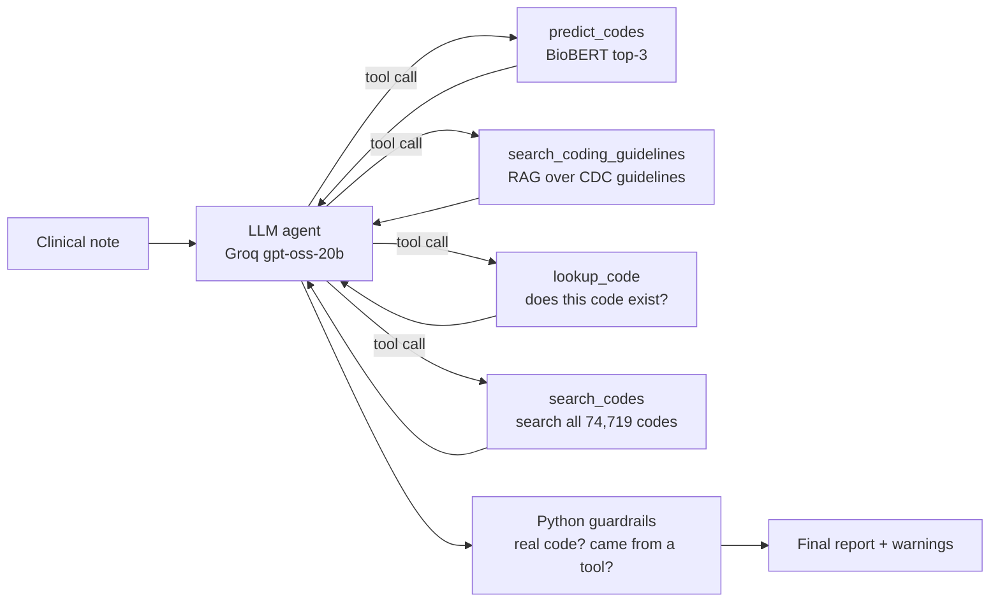
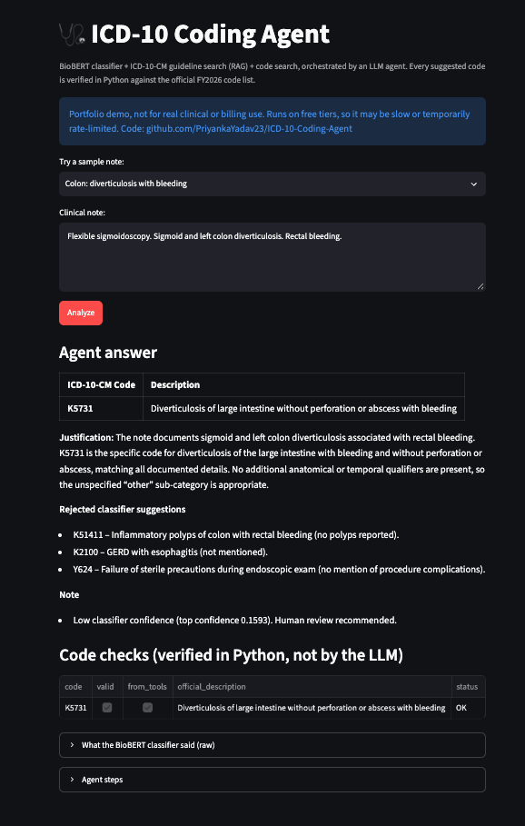

# 🩺 ICD-10 Coding Agent: BioBERT Classifier + Guardrailed LLM Agent

An AI assistant that reads a doctor's clinical note and suggests the official **ICD-10-CM diagnosis codes** used for insurance billing. Every suggested code is checked in Python against the official code list, and a warning is shown whenever the system is unsure.

> ⚠️ Portfolio project. Not for real clinical or billing use. All suggestions need human review.

## 🧠 Machine Learning Pipeline

### Architecture Overview

The system combines four parts:

1. **SapBERT (Weak Labeling)** - Creates training labels by matching each note to its closest official code, since no labeled data was freely available
2. **BioBERT (Classification)** - Fine-tuned on 232 ICD-10 codes, returns the top 3 codes with a confidence score
3. **BGE + RAG (Guideline Search)** - Finds the most relevant passages in the official CDC coding guidelines, with page numbers
4. **LLM Agent (Orchestration)** - Decides which tool to call next, then writes the final answer



### Technical Implementation

- **Weak Labels**: SapBERT understands medical synonyms (like *caries* and *cavity*), so it kept 99.8% of notes, while a TF-IDF baseline kept only 75%
- **Class-Weighted Loss**: Rare codes had low recall, so mistakes on them were given a bigger penalty during training
- **Guideline Chunks**: The 121-page guideline PDF was cleaned and split into 365 overlapping chunks
- **Custom Agent Loop**: Written from scratch (no LangChain), with a 6-step limit, retries, and blocking of repeated calls

## 🛡️ Guardrails: Making the LLM Trustworthy

### The Problem

In the first version, the LLM gave a confident but mostly wrong answer: it picked the wrong code, **invented a 0.96 confidence** (the classifier said 0.16), and **cited guideline pages it never received**.

### How It Is Fixed

- **Tools Only**: The LLM may only recommend codes that a tool actually returned
- **Provenance Check**: Python records every code the tools returned during the run
- **Code Verification**: Every code in the final answer must be a real billable code *and* come from a tool, otherwise a warning banner is added
- **Original Note**: The classifier always gets the doctor's exact note, never the LLM's rewritten version
- **No-Diagnosis Guard**: For text like "hello how are you", Python replies "No codable diagnosis found"

**Main lesson:** a prompt is a request, not a guarantee. Anything that must always be true is checked in code.

## 📊 Results

| What | Result |
|---|---|
| Classifier accuracy (232 codes) | 0.87 |
| Macro recall (rare codes) | 0.88 → **0.92** after class-weighted loss |
| Macro F1 | 0.86 → **0.89** after class-weighted loss |
| 12-note regression test suite | 9 / 12 → **12 / 12** after adding `search_codes` |
| Answers with *only* the expected code | 10 / 12 |

The 12-note suite is a regression check to catch mistakes after changes, not a full benchmark.

## 🎬 Demo

**Live app:** https://icd-10-coding-agent-ecb5fbaqlyplcmvjtmkzfm.streamlit.app/

**Model on Hugging Face:** https://huggingface.co/PriyankaYadav777/biobert-icd10-classifier



*Paste a clinical note and the app shows the suggested codes, a verification table, the classifier's raw output, and every step the agent took.*

## 🛠️ Technology Stack

**Deep Learning & NLP**
- PyTorch
- Hugging Face Transformers (BioBERT, SapBERT)
- sentence-transformers (BGE-small)
- scikit-learn, NumPy, pandas
- pypdf

**LLM Agent**
- Groq API (`openai/gpt-oss-20b`)
- Custom tool-calling loop

**Web Application & API**
- Streamlit
- FastAPI
- Docker

**Hosting**
- Streamlit Community Cloud
- Hugging Face Hub

## 🎮 Features

- **Free-Text Input**: Paste any clinical note in plain English
- **Top-3 Code Suggestions**: Each with its official description and confidence
- **Cited Guidelines**: Rules from the official CDC guidelines, with page numbers
- **Search All Codes**: Finds codes outside the classifier's 232, including left/right and injury codes
- **Verification Table**: Every code is marked OK or CHECK MANUALLY
- **Low-Confidence Warning**: Flags answers that need human review
- **Full Transparency**: Shows every tool call the agent made

## 📁 Project Structure

```
├── sapbert_label_filter.ipynb   # Step 1: SapBERT weak labeling
├── train_biobert.ipynb          # Step 2: BioBERT training + evaluation
├── build_knowledge_base.ipynb   # Step 3: PDF → chunks → embeddings (RAG)
├── agent.ipynb                  # Step-by-step agent development
├── tools.py                     # The 4 agent tools
├── agent.py                     # Agent loop, prompt, retries, guardrails
├── streamlit_app.py             # Public demo app
├── main.py                      # FastAPI: /predict and /analyze
├── app_agent.py                 # Local UI that calls the FastAPI backend
├── run_tests.py                 # 12-note regression test suite
├── upload_model.py              # Uploads the model to Hugging Face Hub
├── data/                        # Code list + prebuilt guideline chunks/vectors
├── Dockerfile                   # Container for the API
└── requirements.txt             # Python dependencies
```

**Not in this repo:** the clinical notes ([Kaggle Medical Transcriptions](https://www.kaggle.com/datasets/tboyle10/medicaltranscriptions)) and the model weights (hosted on Hugging Face Hub).

## 🏆 Technical Achievements

- **Built My Own Training Data**: Weak labels for 4,999 notes against all 74,719 official codes
- **Measured and Fixed Rare-Code Recall**: Class-weighted loss raised macro recall from 0.88 to 0.92
- **Caught Real Hallucinations**: Python checks flagged invented codes, fake confidence, and a "verified" code that does not exist
- **Zero-Cost Deployment**: Free LLM tier, free hosting, model on Hugging Face Hub

## ⚠️ Known Limitations

- Labels come from similarity matching, not from certified coders, so some are noisy
- The classifier knows only 232 codes and predicts one diagnosis per note (shown as top 3)
- The classifier is weaker on short notes, because it was trained on long ones
- LLM answers can vary between runs; the Python checks are the safety net

## 🔮 Future Improvements

- A test set labeled by certified coders
- A multi-label classifier for notes with several diagnoses
- Keyword + embedding (hybrid) code search for synonyms
- A dental layer (CDT codes and tooth-number checks)